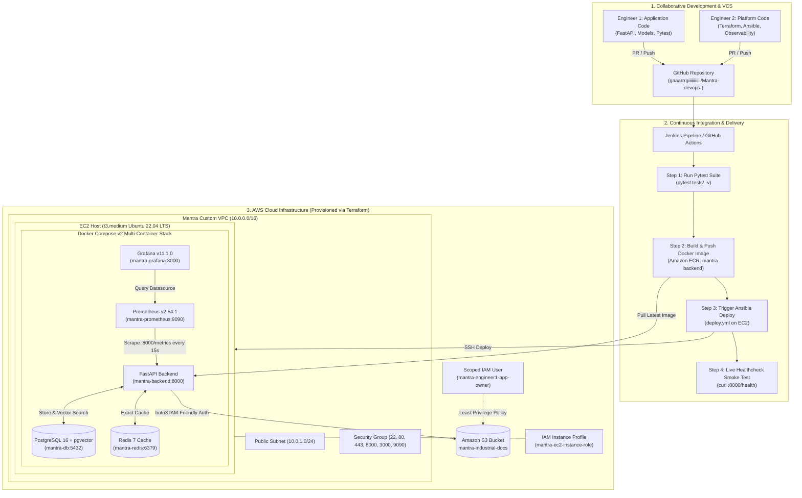

# Mantra Industrial Knowledge Intelligence Platform & DevOps Architecture

[](https://www.python.org/)
[](https://fastapi.tiangolo.com/)
[](https://aws.amazon.com/)
[](https://www.terraform.io/)
[](https://www.docker.com/)
[](https://prometheus.io/)
[](https://grafana.com/)
[]()

> A production-grade industrial knowledge retrieval platform engineered with an end-to-end cloud-native DevOps lifecycle: Infrastructure as Code (IaC), automated configuration management, continuous integration and delivery (CI/CD), containerization, and full-stack observability.

---

## 1. Live Deployment & Telemetry Endpoints

The complete platform is deployed live on AWS EC2 (`t3.medium`) within a custom VPC:

| Service / Component | Port | Live Endpoint | Status / Description |
| :--- | :---: | :--- | :--- |
| **FastAPI Backend (Liveness)** | `8000` | [`http://3.210.183.205:8000/health`](http://3.210.183.205:8000/health) | `{"status":"healthy","service":"mantra-backend",...}` |
| **Service Readiness Probe** | `8000` | [`http://3.210.183.205:8000/ready`](http://3.210.183.205:8000/ready) | `{"status":"ready","database":"connected","redis":"connected"}` |
| **Prometheus Metrics Hook** | `8000` | [`http://3.210.183.205:8000/metrics`](http://3.210.183.205:8000/metrics) | Real-time RED metrics, HTTP throughput, latency, GC & memory |
| **Grafana Monitoring Dashboard** | `3000` | [`http://3.210.183.205:3000`](http://3.210.183.205:3000) | Pre-provisioned *"Mantra Industrial DevOps Overview"* (`admin` / `mantra_admin_2026`) |
| **Prometheus Server & Targets** | `9090` | [`http://3.210.183.205:9090/targets`](http://3.210.183.205:9090/targets) | Active scrape targets (`mantra-backend` & `prometheus` **UP**) + Alert rules |
| **API Documentation (Swagger)** | `8000` | [`http://3.210.183.205:8000/docs`](http://3.210.183.205:8000/docs) | Interactive OpenAPI / Swagger interface |

---

## 2. 2-Engineer Collaborative DevOps Model

The project is built on an industry-standard collaborative DevOps division between the **Platform Owner** and the **Application Owner**:

```
               ┌────────────────────────────────────────────────────────┐
               │                MANTRA DEVOPS PLATFORM                  │
               └────────────────────────────────────────────────────────┘
                       │                                        │
                       ▼                                        ▼
      ┌─────────────────────────────────┐      ┌─────────────────────────────────┐
      │   TEAMMATE: Application Owner   │      │      YOU: Platform Owner        │
      │         (Ayush Gourav)          │      │            (Gargi)              │
      ├─────────────────────────────────┤      ├─────────────────────────────────┤
      │ • FastAPI backend & API routers │      │ • AWS VPC, Subnets, EC2, SG    │
      │ • PostgreSQL + pgvector + Redis │      │ • Terraform IaC (S3 Backend)    │
      │ • Multi-stage Dockerfile        │      │ • Ansible provisioning playbook │
      │ • Pytest suite (tests/)         │      │ • Jenkins CI/CD & AWS ECR       │
      │ • Telemetry /metrics endpoint   │      │ • Prometheus & Grafana stack    │
      │ • React + Vite frontend         │      │ • Scoped IAM Policies & Access  │
      └─────────────────────────────────┘      └─────────────────────────────────┘
```

---

## 3. High-Level DevOps & Cloud Architecture



---

## 4. Key Architectural Pillars

### A. Infrastructure as Code (Terraform)
* **Remote State Management:** Configured with an S3 backend (`mantra-terraform-state-2026`) and DynamoDB state locking (`mantra-terraform-locks`).
* **Network Topology:** Isolated VPC (`10.0.0.0/16`), public subnet (`10.0.1.0/24`), Internet Gateway, and Route Tables.
* **Security Groups:** Strictly controlled ingress allowing ports `22` (SSH), `80/443` (HTTP/S), `8000` (FastAPI), `3000` (Grafana), and `9090` (Prometheus). Database ports `5432` and `6379` remain completely isolated inside the Docker bridge network.
* **Managed Cloud Storage & Registry:** S3 bucket (`mantra-industrial-docs-657157860151`) with AES-256 server-side encryption, versioning, and public access blocks; private Amazon ECR repository (`mantra-backend`).

### B. Security & IAM Least-Privilege Access
* **EC2 IAM Role (`mantra-ec2-instance-role`):** Directly attached via an IAM Instance Profile. Authorizes the application to interact with S3, pull from ECR, and stream logs to CloudWatch without storing AWS access keys in environment variables or code.
* **Scoped Developer User (`mantra-engineer1-app-owner`):** Dedicated IAM user for Engineer 1 attached to `mantra-engineer1-developer-policy`. Restricts access exclusively to industrial document storage and log streams, barring access to modify compute or network infrastructure.

### C. Multi-Container Orchestration (Docker Compose)
* **Service Composition:** 5 coordinated services (`backend`, `db`, `redis`, `prometheus`, `grafana`).
* **Resilience:** All production containers configured with `restart: unless-stopped` for automatic self-healing across host reboots.
* **Startup Ordering:** Docker health checks (`pg_isready -U mantra_user -d mantra_db` and `redis-cli ping`) ensure the FastAPI backend boots only after storage dependencies report healthy (`condition: service_healthy`).

### D. Observability & Alerting Stack
* **Prometheus:** Continuously scrapes `/metrics` from `backend:8000` on a 15-second cycle. Includes pre-loaded alert rules in `prometheus/alert.rules.yml` for:
  * `MantraBackendDown`: Fires if `up{job="mantra-backend"} == 0` for $\ge 1$ minute.
  * `MantraHighErrorRate`: Fires if 5xx responses exceed 5% of total traffic.
* **Grafana:** Automated provisioning (`grafana/provisioning/`) with Prometheus auto-registered as default datasource, and a pre-configured dashboard displaying:
  * Service uptime and health badges
  * HTTP Request throughput & RED metrics
  * Latency percentiles ($p50$ and $p95$)
  * Process memory (RSS vs. Virtual) and CPU utilization

### E. Automated CI/CD Pipelines
* **Jenkins Pipeline (`Jenkinsfile`):** Automated stages covering Code Checkout $\rightarrow$ Virtualenv Setup & Pytest Execution $\rightarrow$ Static Code Quality Gate $\rightarrow$ Multi-stage Docker Build & ECR Push $\rightarrow$ Remote Ansible Deployment $\rightarrow$ Endpoint Smoke Testing.
* **GitHub Actions (`.github/workflows/ci-cd.yml`):** Synchronous pull request and push validation on `main`.

---

## 5. Repository Structure

```text
Mantra/
├── .github/workflows/
│   └── ci-cd.yml                   # GitHub Actions automated CI/CD pipeline
├── Jenkinsfile                     # Declarative Jenkins CI/CD pipeline
├── docker-compose.yml              # 5-tier production multi-container orchestration
├── MANTRA_DEVOPS_PLAN.md           # 2-Engineer operational playbook & collaboration contract
├── README.md                       # Platform overview, architecture diagrams, & endpoints
├── backend/
│   ├── Dockerfile                  # Multi-stage production container image (non-root appuser)
│   ├── requirements.txt            # Pinned application dependencies
│   └── app/
│       ├── main.py                 # FastAPI application, /health, /ready, & /metrics hooks
│       ├── config.py               # Pydantic BaseSettings 12-factor configuration
│       ├── database.py             # PostgreSQL + pgvector connection pool
│       └── storage.py              # IAM-compatible S3 document storage abstraction
├── frontend/                       # React + TypeScript + Vite user interface
├── tests/
│   ├── conftest.py                 # Pytest fixtures and mock client
│   └── test_health.py              # Liveness and readiness smoke tests (100% passing)
├── terraform/
│   ├── backend.tf                  # S3 remote state + DynamoDB distributed lock
│   ├── providers.tf                # HashiCorp AWS provider
│   ├── main.tf                     # VPC, Subnet, IGW, SecGroup, EC2, S3, ECR, IAM
│   ├── variables.tf                # Configurable infrastructure parameters
│   └── outputs.tf                  # Public IP, bucket names, and resource identifiers
├── ansible/
│   ├── inventory/
│   │   └── hosts.ini               # EC2 target host connection configuration
│   └── playbooks/
│       └── deploy.yml              # Automated host provisioning & compose sync playbook
├── prometheus/
│   ├── prometheus.yml              # Scrape configuration targeting backend:8000/metrics
│   └── alert.rules.yml             # Threshold-based alerting rules
└── grafana/
    └── provisioning/
        ├── datasources/            # Automated Prometheus datasource registration
        └── dashboards/             # Pre-loaded "Mantra Industrial DevOps Overview" dashboard
```

---

## 6. Local Quickstart

### Run Test Suite Locally
```bash
python -m pip install -r backend/requirements.txt pytest httpx
pytest tests/ -v
```

### Run Entire Stack with Docker Compose
```bash
docker compose up -d --build
```
* Backend API: `http://localhost:8000/docs`
* Grafana: `http://localhost:3000`
* Prometheus: `http://localhost:9090`
