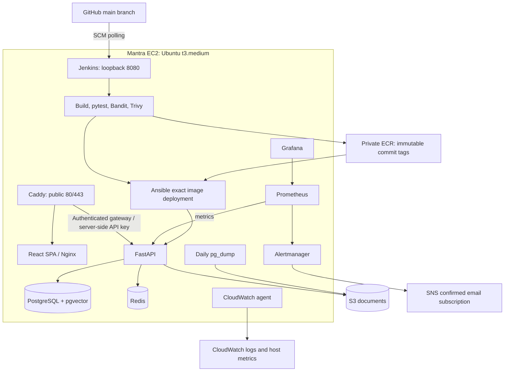

# Mantra Industrial Knowledge Intelligence Platform

Mantra combines a FastAPI knowledge API and React frontend with a single-host AWS DevOps platform. The platform owner maintains infrastructure, deployment, CI and monitoring; the application owner maintains retrieval, ingestion, application tests and schema migrations.

See [PLATFORM_VERIFICATION.md](PLATFORM_VERIFICATION.md) for dated verification results and outstanding dependencies. The original [DevOps plan](MANTRA_DEVOPS_PLAN.md) describes the work allocation; its example credentials and historical topology are not production configuration.

## Architecture



Only the gateway is public. SSH requires the configured operator CIDR. Databases have no host port bindings. Monitoring ports bind to loopback, and Jenkins listens on `127.0.0.1:8080`. The instance profile supplies AWS credentials; access keys are not embedded in application configuration.

## Configuration and access

Copy `.env.example` to `.env`, replace every placeholder, and protect it with `chmod 600`. Use URL-safe database passwords because the connection URL embeds the password. Generate the gateway's bcrypt hash using `caddy hash-password`; preserve its dollar signs by single-quoting the `.env` value. Keep runtime credentials outside Git. Existing deployments use `/opt/mantra/.env`.

`MANTRA_SITE_ADDRESS=:80` provides HTTP for local setup. Production can use the permanent public IP with Let's Encrypt's `shortlived` certificate profile, or a DNS hostname whose A record points at the Elastic IP. Caddy renews certificates automatically. Verify the issued certificate before claiming HTTPS is operational. [IP certificates](https://letsencrypt.org/2026/01/15/6day-and-ip-general-availability), [Caddy HTTPS documentation](https://caddyserver.com/docs/automatic-https).

The frontend and `/api/*` use gateway Basic authentication. The gateway adds the backend API key only after authentication. `/health` and `/ready` are public probes. Monitoring credentials are separate. A future application token flow can replace gateway authentication.

For an existing deployment, rotated web and Grafana credentials are stored only in `/root/mantra-access.json`; retrieve them privately over SSH with `sudo`. The Jenkins username is `mantra-admin`; its generated password is in `/var/lib/jenkins/secrets/mantra-admin-password`. Neither file should be copied into chat, Git or screenshots.

Create private tunnels from your workstation:

```bash
ssh -i ~/.ssh/mantra-key.pem -L 8080:127.0.0.1:8080 -L 3000:127.0.0.1:3000 -L 9090:127.0.0.1:9090 ubuntu@32.193.54.28
```

Jenkins is then available at `http://localhost:8080`, Grafana at `http://localhost:3000/grafana/`, and Prometheus at `http://localhost:9090`.

## Infrastructure and deployment

```bash
cp terraform/terraform.tfvars.example terraform/terraform.tfvars
# Set a restricted SSH CIDR, actual bucket name and alert email.
terraform -chdir=terraform init
terraform -chdir=terraform plan
terraform -chdir=terraform apply
ansible-playbook -i ansible/inventory/hosts.ini ansible/playbooks/jenkins.yml
scripts/deploy-ec2.sh ACCOUNT.dkr.ecr.us-east-1.amazonaws.com/mantra-backend:FULL_GIT_COMMIT
```

The Terraform S3 backend and DynamoDB lock table must already exist. Backend state is encrypted. EC2 replacement is guarded; AMI changes require a deliberate upgrade. The Ansible deployment copies the required sources and configuration, pulls the exact ECR image, enables pgvector on existing volumes, synchronizes Grafana credentials, schedules backups and waits for actual database/Redis readiness.

Jenkins polls the configured repository's `main` branch every five minutes. Its pipeline builds a Python 3.11 runtime image, runs pytest in that image, runs Bandit and Trivy, pushes a commit tag, and deploys through a dedicated SSH credential. Trivy retains every high/critical finding and blocks findings with available fixes; vendor-unpatched findings remain in the archived report. The controller uses its EC2 role for scoped ECR push access. GitHub Actions runs independent pull request validation. Do not run both systems as competing deployment controllers.

Schema migrations remain an application handoff: this repository currently has no Alembic migration directory. Ansible detects `/app/alembic.ini` in the runtime image and runs `alembic upgrade head` before starting the API when the application owner supplies that package. Turn `IKI_AUTO_CREATE_SCHEMA` off when adopting migrations; until then the current schema bootstrap remains enabled.

## Verification and recovery

```bash
python -m pytest tests -q
terraform fmt -check -recursive terraform
terraform -chdir=terraform validate
docker compose --env-file .env.example config --quiet
```

`scripts/validate-containers.sh` runs an isolated eight-service stack on loopback test ports, verifies authentication, SPA routing, real dependency failures, metrics, pgvector, port isolation and database restore, then removes only its disposable project volumes. Run it from an extracted package, not `/opt/mantra`.

Production backups run daily at 07:30 Asia/Kolkata (02:00 UTC) through `/usr/local/sbin/mantra-backup-db`. Verify recovery with `scripts/verify-backup-restore.sh s3://BUCKET/backups/FILE.sql.gz`; it restores into a disposable database and does not replace production data. Backup logs are collected in CloudWatch.

Alertmanager routes alerts to the Terraform-managed SNS topic. The email recipient must confirm the subscription before delivery can be verified. [Prometheus receiver configuration](https://prometheus.io/docs/alerting/latest/configuration/).
