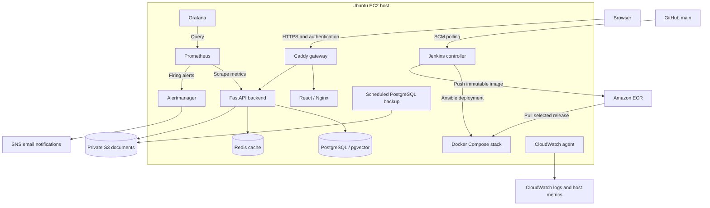

# Mantra — Industrial Knowledge Intelligence Platform

Mantra turns industrial maintenance documents into searchable, connected knowledge. Users can upload work orders, inspections and incident reports, ask questions with source citations, explore equipment relationships, and inspect maintenance, compliance and failure evidence through a React interface.

The repository includes the application and its AWS delivery platform: Terraform infrastructure, Ansible automation, Docker Compose, GitHub Actions validation, Jenkins deployment, Prometheus, Grafana, Alertmanager, CloudWatch and S3 database backups.

## Application capabilities

| Area | What it provides |
|---|---|
| Document ingestion | Parse, chunk and index PDF, DOCX, XLSX, PPTX, email, text and image documents; OCR is available for supported image content. |
| Knowledge copilot | Search indexed evidence and return answers with source citations through standard or streaming endpoints. |
| Knowledge graph | Explore extracted equipment, procedures, regulations, parts and relationships. |
| Maintenance and RCA | Inspect equipment history, maintenance recommendations and evidence-linked root-cause analysis. |
| Compliance | Find regulation references, equipment evidence and potential gaps. |
| Failure intelligence | Inspect incidents, similar records and patterns supported by the configured provider mode. |
| Administration | Inspect document and request information, ingestion failures and reprocessing. |

The Ingest page includes three sample PDFs about pump **P-205B**, compressor **K-330** and incident **INC-2026-050**. Ingest them, then ask **“What happened to P-205B?”** or **“How are P-205B and K-330 connected?”** Open the cited sources to inspect the supporting evidence.

The backend supports deterministic operation and optional model providers. Provider and embedding settings are documented in [backend/README.md](backend/README.md). Some analysis depends on the selected provider and available documents.

## Architecture

The deployed architecture runs eight Compose services and a native Jenkins controller on one Ubuntu EC2 host. Terraform also provisions the supporting AWS services.



| Component | Purpose |
|---|---|
| React, TypeScript, Vite | Browser interface and production frontend build |
| FastAPI / Python | Ingestion, retrieval, graph, maintenance and administration API |
| PostgreSQL + pgvector | Durable application records, vector search and full-text retrieval |
| Redis | Exact-answer cache |
| Amazon S3 | Raw documents and compressed database backups |
| Caddy | HTTPS, browser authentication and API proxying |
| Docker Compose | Service networking, restart policy and persistent volumes |
| Jenkins | Build, runtime testing, security scanning and deployment |
| Prometheus / Grafana | Metrics collection and dashboards |
| Alertmanager / SNS | Alert grouping and email notification routing |
| CloudWatch agent | Host/container logs and configured host metrics |

This is a single-host deployment. Jenkins and the application share EC2 resources; the architecture does not provide multi-host failover.

## Infrastructure as code: Terraform

[terraform/](terraform/) provisions the VPC, public subnet, routing, security group, EC2 instance and Elastic IP; document bucket protections; ECR; IAM roles and scoped engineer access; SNS; CloudWatch log groups; and the restricted Session Manager document.

- The instance profile supplies AWS permissions to the host and supported workloads.
- S3 document storage has encryption, versioning and public-access blocking.
- ECR tags are immutable, and push permissions are scoped to the project repository.
- Terraform state uses an encrypted S3 backend and DynamoDB locking. Create the backend bucket and lock table before initialization.
- Production environment files, state files, workstation keys and actual `terraform.tfvars` are ignored by Git.

From a workstation/control host with Terraform, AWS CLI and authorized AWS credentials:

```bash
cp terraform/terraform.tfvars.example terraform/terraform.tfvars
# Set your current public IP /32, key-pair name, unique bucket and alert email.
terraform -chdir=terraform init
terraform -chdir=terraform fmt -check
terraform -chdir=terraform validate
terraform -chdir=terraform plan
terraform -chdir=terraform apply
terraform -chdir=terraform output
```

Review the plan before applying. The example values and remote backend are specific to this project and must be adapted for another AWS account. Terraform changes are applied separately; Jenkins does not run `terraform apply` for every application release.

## Configuration management and deployment: Ansible

[ansible/playbooks/deploy.yml](ansible/playbooks/deploy.yml) configures the EC2 host and deploys an immutable backend image. It installs prerequisites, configures CloudWatch, copies stack configuration, pulls the selected ECR image, checks dependencies, backs up PostgreSQL, applies packaged migrations and starts the stack. It also installs backup scheduling and verifies service readiness.

The [gateway activation tasks](ansible/tasks/activate-gateway.yml) compare desired and mounted configuration, validate changes and recreate the gateway only when necessary. Unchanged configuration does not require recreation.

Additional playbooks configure [Jenkins](ansible/playbooks/jenkins.yml), [engineer access](ansible/playbooks/engineer-access.yml) and [restricted teammate sessions](ansible/playbooks/teammate-access.yml). Review [the inventory](ansible/inventory/hosts.ini) before targeting another host.

From a Linux/WSL control environment with Ansible and authorized SSH access:

```bash
ansible-playbook -i ansible/inventory/hosts.ini ansible/playbooks/jenkins.yml
bash scripts/deploy-ec2.sh ACCOUNT.dkr.ecr.us-east-1.amazonaws.com/mantra-backend:FULL_GIT_COMMIT \
  --private-key /path/to/operator-key.pem \
  -e mantra_require_migrations=true
```

Replace the account, full 40-character commit and private-key path. Deployment also accepts an ECR SHA-256 digest. Mutable tags such as `latest` are rejected. The selected image must already exist in ECR, and protected production configuration must already be prepared on the host.

## CI/CD flow

```mermaid
flowchart LR
    Branch[Feature branch] --> PR[Pull request]
    PR --> CI[GitHub Actions checks]
    CI --> Review[Required approval]
    Review --> Main[Merge main]
    Main -->|Poll every five minutes| Jenkins[Jenkins pipeline]
    Jenkins --> Tests[Runtime tests and scans]
    Tests --> ECR[Commit-tagged image in ECR]
    ECR --> Ansible[Ansible deployment]
    Ansible --> Live[EC2 running the selected release]
```



### GitHub Actions: pull-request validation

[.github/workflows/ci-cd.yml](.github/workflows/ci-cd.yml) runs for pull requests targeting `main` and pushes to `main`. Required jobs are:

| Job | Validation |
|---|---|
| `schema-contract` | Require migration packaging when database setup/models change |
| `test` | Backend tests with PostgreSQL, Bandit analysis, Prometheus rule tests and gateway activation regression |
| `frontend-build` | Install locked frontend dependencies and build TypeScript/Vite assets |
| `docker-build` | Build containers, verify packaged migrations, test the exact runtime image with disposable PostgreSQL, check test-volume cleanup and scan vulnerabilities |

The configured `main` protections require these checks and an approving review, enforce up-to-date checks, and block force pushes and deletion. Path ownership is recorded in [.github/CODEOWNERS](.github/CODEOWNERS); actual enforcement is configured in GitHub settings.

### Jenkins: build and delivery

The EC2-hosted `Mantra` job reads [Jenkinsfile](Jenkinsfile) from canonical `main`. SCM polling uses `H/5 * * * *`: a new main commit is normally detected within five minutes. **Build Now** starts a run immediately and can redeploy the current main release. Uploading documents or asking questions does not trigger Jenkins.

| Stage | Action |
|---|---|
| Checkout | Fetch the selected source revision |
| Static analysis | Run Bandit and Prometheus alert-rule tests |
| Build image | Build the commit-tagged backend image, or reuse its existing immutable ECR image |
| Test exact runtime image | Run backend tests against disposable PostgreSQL using the image intended for release |
| Scan image | Retain the full HIGH/CRITICAL report and apply the Trivy release gate |
| Push image | Publish the immutable commit tag on main, unless it already exists |
| Deploy exact image | Invoke Ansible with that image reference |

The Trivy gate blocks HIGH/CRITICAL findings with available fixes; vendor-unpatched findings remain visible in the retained report. A passing gate does not mean the image has zero vulnerabilities. Jenkins serializes builds and retains recent build history. GitHub Actions validates changes independently; Jenkins is the production deployment controller.

## Configuration and local startup

Prerequisites: Git and Docker with Compose v2. AWS-backed deployments also need AWS CLI, Terraform, an Ansible control environment, an EC2 key pair and the required AWS permissions. Container builds provide the pinned backend runtime; frontend development uses Node/npm as described in [frontend/README.md](frontend/README.md).

```bash
cp .env.example .env
# Replace every CHANGE_ME value and set the site, storage and access configuration.
chmod 600 .env
```

Generate the web password hash with `caddy hash-password`; single-quote its `.env` value to preserve bcrypt dollar signs. Use URL-safe database passwords because the database connection URL embeds the password.

| Setting | Purpose |
|---|---|
| `MANTRA_SITE_ADDRESS` | `:80` for local HTTP; HTTPS IP/hostname for deployment |
| `MANTRA_TLS_SERVER_NAME` | Public IP/hostname used for TLS; `localhost` for local setup |
| `MANTRA_ACME_EMAIL` | Certificate contact |
| `MANTRA_WEB_USER`, `MANTRA_WEB_PASSWORD_HASH` | Gateway browser login |
| `IKI_API_KEY` | Backend key supplied server-side by the gateway |
| `POSTGRES_PASSWORD` | Database credential |
| `GRAFANA_ADMIN_USER`, `GRAFANA_ADMIN_PASSWORD` | Separate Grafana login |
| `IKI_S3_BUCKET`, `AWS_REGION` | AWS document storage settings |
| `IKI_STORAGE_BACKEND` | `s3` by default; use `local` for a local-only smoke run |
| `MANTRA_BACKEND_IMAGE` | Local image name or immutable deployment reference |

For a fresh local stack, choose `IKI_STORAGE_BACKEND=local` in `.env` if AWS storage is not being used, then run:

```bash
docker compose build backend frontend
docker compose up -d --wait db redis
docker compose run --rm --no-deps backend alembic upgrade head
docker compose up -d --no-build
docker compose ps
```

Local raw document storage in this mode is not configured as durable production storage. Use the S3-backed deployment for production document persistence. Never run disposable tests against production volumes.

Database revisions live in [backend/migrations/](backend/migrations/). Production disables automatic schema creation with `IKI_AUTO_CREATE_SCHEMA=false`. Alembic upgrades run before API startup; native retrieval migrations backfill saved vectors and create search indexes. Detailed database/provider instructions are in [backend/README.md](backend/README.md).

## Network access and credentials

Only gateway ports 80/443 are publicly exposed for the application. Administrative SSH is restricted to the configured operator CIDR. PostgreSQL, Redis and the API have no public host bindings. Monitoring binds to loopback, and native Jenkins listens on loopback port 8080.

The frontend and `/api/*` require gateway Basic authentication; the gateway injects the backend key. `/health` and `/ready` are public probes. HTTPS is provided by Caddy with automatic certificate renewal and persistent certificate storage. Confirm normal certificate validation for the configured IP/hostname.

On the existing operator host, application configuration is `/opt/mantra/.env` with mode 0600. Existing web/Grafana access details are in `/root/mantra-access.json`; Jenkins credentials are protected under `/var/lib/jenkins/secrets/`. Retrieve access privately. Do not commit or publish credentials, private keys, state files or environment files.

The current demonstration application is available at **https://32.193.54.28/** with its assigned web credentials. Open private tools through an SSH tunnel and keep that session running:

```bash
ssh -N -i ~/.ssh/mantra-key.pem \
  -L 127.0.0.1:48080:127.0.0.1:8080 \
  -L 127.0.0.1:3000:127.0.0.1:3000 \
  -L 127.0.0.1:9090:127.0.0.1:9090 \
  -L 127.0.0.1:9093:127.0.0.1:9093 \
  -o ExitOnForwardFailure=yes -o ServerAliveInterval=30 -o ServerAliveCountMax=3 \
  ubuntu@32.193.54.28
```

| Tool | Local address |
|---|---|
| Jenkins | http://127.0.0.1:48080/job/Mantra/ |
| Grafana | http://127.0.0.1:3000/grafana/d/mantra-overview |
| Prometheus | http://127.0.0.1:9090/targets |
| Alertmanager | http://127.0.0.1:9093/#/alerts |

A refused localhost connection usually means the tunnel is absent. An SSH timeout after changing networks can mean the current public IP no longer matches the allowed CIDR; update the restricted rule through the authorized infrastructure process. Do not open administrative ports publicly as a workaround.

The application engineer can use the scoped Session Manager document as the separate non-admin `mantra-app` account. Platform administration and production secrets remain restricted. See [terraform/teammate-access.tf](terraform/teammate-access.tf) and [ansible/playbooks/teammate-access.yml](ansible/playbooks/teammate-access.yml).

## Metrics, dashboards and alerts

Prometheus scrapes every 15 seconds and evaluates rules every 15 seconds. The provisioned Grafana dashboard shows backend/Prometheus health, endpoint request rate/status, p50/p95 latency, backend process CPU and memory. CloudWatch collects configured host/container logs with 14-day log retention.

Useful expressions in Prometheus:

```promql
up{job="mantra-backend"}
```

```promql
sum by (handler, status) (rate(http_requests_total{job="mantra-backend"}[2m]))
```

```promql
sum(increase(http_requests_total{job="mantra-backend",method="POST",handler=~"/api/copilot/(ask|stream)"}[5m]))
```

A healthy scrape returns `up = 1`. Generate application traffic, wait 15–30 seconds, then inspect the endpoint series. `increase()` estimates counts between scrapes and may return fractional values; monitoring probes also generate traffic.

| Alert | Condition |
|---|---|
| `MantraBackendDown` | Backend scrape remains down for one minute |
| `MantraHighErrorRate` | HTTP 5xx ratio exceeds 5% over a two-minute rate window, sustained for two minutes |

Notifications flow **Prometheus → Alertmanager → SNS → confirmed email subscription**. Initial grouping waits 30 seconds; repeated/grouped notifications follow [the Alertmanager configuration](prometheus/alertmanager.yml). Empty Alertmanager is normal when no alerts are firing. Directly injecting a synthetic Alertmanager alert tests routing/email but does not test Prometheus rule evaluation.

## Backups, recovery and operational verification

Ansible installs a daily PostgreSQL-to-S3 backup at **02:00 UTC / 07:30 Asia/Kolkata**, and deployment creates a pre-migration backup. Logs are collected by CloudWatch.

```bash
# On EC2, create a backup using protected production settings.
sudo /usr/local/sbin/mantra-backup-db

# From an authorized checkout, restore a selected backup into a disposable database.
sudo bash scripts/verify-backup-restore.sh s3://BUCKET/backups/SELECTED_BACKUP.sql.gz
```

The restore drill does not replace the production database. Retain and verify backups before recovery operations. Use a previous compatible immutable image for application rollback; migrations are forward-only, so an image rollback does not undo database changes. Ansible preserves previous protected configuration at `/root/mantra-previous-release.env` after successful migration.

On EC2, from an authorized source checkout:

```bash
sudo python3 scripts/verify-live.py
sudo python3 scripts/release-evidence.py --expected-commit FULL_GIT_COMMIT --require-application
```

The live platform verifier checks HTTPS, authentication, isolation, storage, monitoring and backup scheduling; it creates and deletes a disposable S3 verification object. Release evidence compares the running image with the intended commit/ECR digest and checks backup freshness, TLS validity and migration metadata. `--test-alert` on the live verifier sends a notification test; `--exercise-recovery` also runs a backup/restore drill. Use these flags intentionally.

Monitor available disk space because builds, images, logs and PostgreSQL share the host. Keep certificate renewal, backup freshness, restore drills, patching and vulnerability-report review in the operating routine. Container restart policies help recovery but do not replace host availability planning.

## Repository layout

```text
.github/       GitHub Actions and path ownership
ansible/       Host, access, Jenkins and deployment automation
backend/       FastAPI application, dependencies and Alembic revisions
frontend/      React interface and sample documents
grafana/       Provisioned dashboard and Prometheus data source
jenkins/       Controller bootstrap and required plugins
postgres/      PostgreSQL extension initialization
prometheus/    Scraping, alert rules, rule tests and alert routing
scripts/       Deployment, backup, verification and security utilities
terraform/     AWS infrastructure and scoped access
tests/        Backend, persistence, readiness and feature tests
```

Team handoff notes, local guides and dated verification reports belong in ignored local storage such as `.local/`, outside the versioned source tree. Keep reproducible code, tests, operational configuration and maintained documentation in Git.

## Validation commands

```bash
terraform fmt -check -recursive terraform
terraform -chdir=terraform validate
docker compose --env-file .env.example config --quiet
```

For backend tests use the dependencies/environment in the [CI workflow](.github/workflows/ci-cd.yml), including disposable PostgreSQL for database integration tests. [scripts/test-runtime-image.sh](scripts/test-runtime-image.sh) tests the exact backend image using an isolated database and cleans up its test resources. [scripts/validate-containers.sh](scripts/validate-containers.sh) exercises a disposable full stack and recovery paths; run it outside `/opt/mantra` and preserve production volumes.
